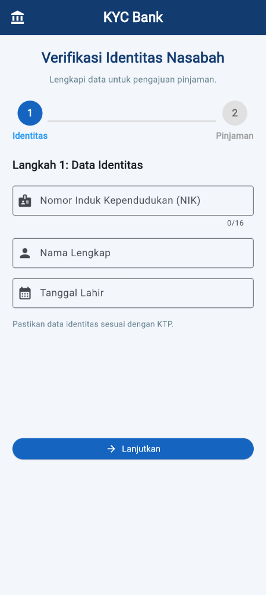

# Flutter KYC Bank App

Aplikasi formulir KYC (*Know Your Customer*) dan simulasi pengajuan pinjaman nasabah bank berbasis **Flutter** dengan tampilan antarmuka modern Material 3.

<p align="center">
  
</p>

## Fitur Utama

- **Multi-step Onboarding / Form**: Alur pendaftaran terstruktur bertahap (Data Diri & Pengajuan Pinjaman).
- **Validasi Data**:
  - Validasi NIK (wajib 16 digit angka).
  - Validasi Nama Lengkap (hanya huruf & spasi, tanpa angka).
  - Validasi Tanggal Lahir & kalkulasi usia otomatis.
  - Validasi Nominal Pinjaman.
- **Interaksi & UX**:
  - Haptic feedback saat fokus input aktif.
  - Simulasi error jaringan untuk pengujian status failure/success.
  - Animasi transisi halaman yang halus.
- **Desain Modern**: Tema Material 3 dengan palet warna perbankan biru elegan (`#1565C0`).

## Menjalankan Aplikasi

Pastikan Flutter SDK sudah terpasang di sistem Anda.

1. Clone repositori ini:
   ```bash
   git clone https://github.com/ghostfaceeeeee/flutter-kyc-bank.git
   cd flutter-kyc-bank
   ```

2. Unduh dependensi:
   ```bash
   flutter pub get
   ```

3. Jalankan aplikasi:
   - Di Web:
     ```bash
     flutter run -d chrome
     # atau
     flutter run -d web-server --web-port=8080
     ```
   - Di Desktop Windows:
     ```bash
     flutter run -d windows
     ```

## Teknologi & Environment
- **Framework**: Flutter (Dart SDK `^3.13.4`)
- **UI System**: Material 3
- **Icons**: Cupertino Icons
